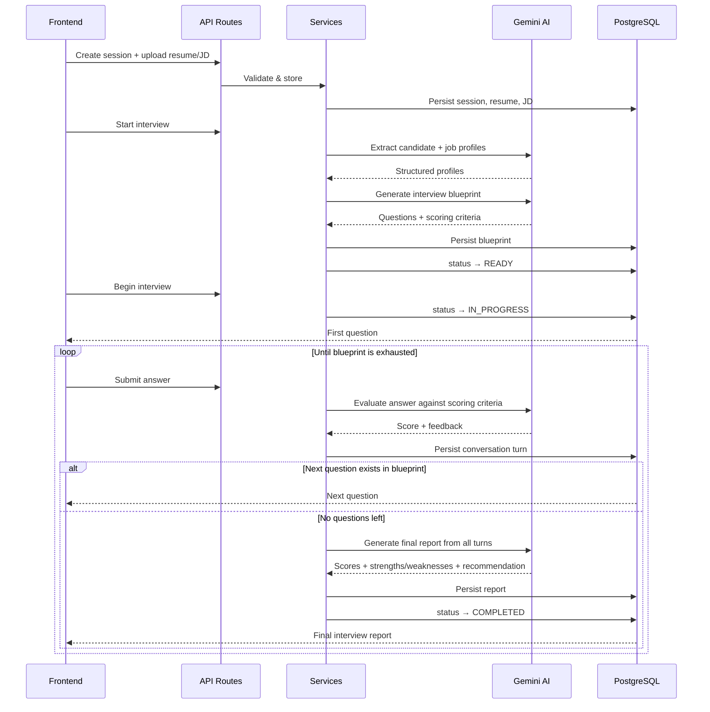
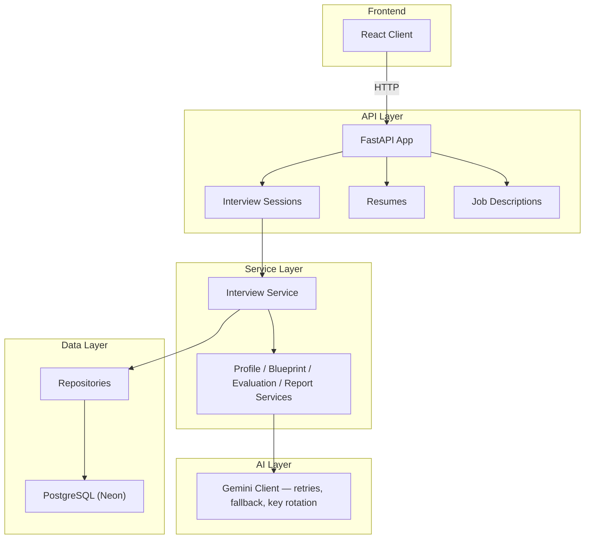
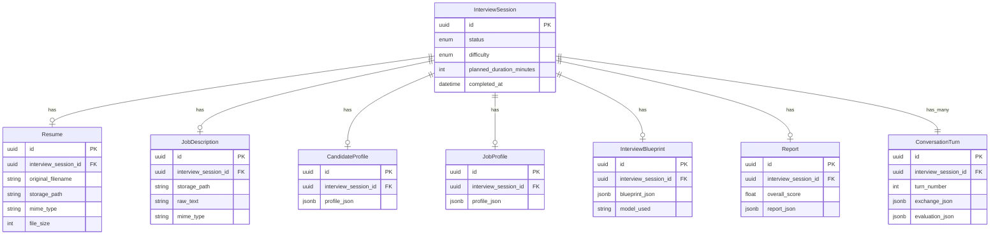

# AiiN — AI-Powered Mock Interview Platform

AiiN turns a resume and a job description into a tailored mock interview. AI generates the questions and evaluates rubric evidence; application code validates the scores, calculates all totals and percentages, and applies fixed recommendation thresholds.

**Stack:** FastAPI · PostgreSQL (Neon) · SQLAlchemy · Google Gemini · React

---

## Why This Project

Most "AI interview" tools ask generic questions. AiiN builds the interview *from the actual resume and job description* — every question is grounded in the candidate's real background and the role's real requirements, and every evaluation accounts for how the answer was given (including tolerating speech-to-text transcription artifacts, e.g. "UART" transcribed as "you are tea," so candidates aren't penalized for STT noise).

---

## How It Works

1. **Upload** — candidate submits a resume (PDF/DOCX) and a job description
2. **Parse** — text is extracted and sent to Gemini to build structured `CandidateProfile` and `JobProfile` objects
3. **Blueprint** — Gemini generates tailored questions and question-specific evidence checks; the backend enforces the fixed question count, section mix, difficulty, and scoring rubric
4. **Interview loop** — a single endpoint (`POST /{id}/answer`) drives the whole interview:
   - Gemini evaluates each fixed rubric criterion and returns answer excerpts as evidence
   - The backend validates evidence and score bounds, then calculates per-answer scores
   - The turn (question, answer, evaluation) is persisted
   - The service checks the blueprint for a next question:
     - **If one exists**, it's returned immediately, the candidate keeps going
     - **If none is left**, the same call calculates the final scores and recommendation in code, asks Gemini only for a narrative synthesis, marks the session `COMPLETED`, and returns the report
   - This means there's no separate "end interview" step, the last answer and the report come back in one response



---

## Architecture

Layered architecture: routes stay thin, all business logic lives in services, all SQL is isolated in a repository layer.



**Interview state machine:**
`CREATED → PARSING → READY → IN_PROGRESS → COMPLETED` (with a `FAILED` branch on error)

---

## Key Engineering Decisions

| Decision | Why |
|---|---|
| **Structured AI output** (`response_schema` on every Gemini call) | Every AI response is validated against a Pydantic schema — no brittle regex parsing of free-form text |
| **Model + key fallback chain** in the Gemini client | Retries with exponential backoff, falls back across models (`gemini-3.6-flash` → `gemini-3.5-flash` → `gemini-3.1-flash-lite`), and alternates API keys to survive rate limits and 503s |
| **Repository pattern** | All SQL isolated from business logic — services never touch the DB directly |
| **State machine on interview status** | Prevents invalid transitions (e.g. can't submit an answer to a completed interview) |
| **STT-aware evaluation prompt** | Answer scoring explicitly discounts transcription artifacts instead of penalizing candidates for them |

---

## Difficulty, Question Count, and Scoring Contract

The interview design and scoring rules are versioned (`rubric-v1`) and stored
with each generated blueprint/report.

| Selected level | Intended experience | What questions and evaluation expect |
|---|---|---|
| Easy | Fresher / entry-level, typically 0-1 years | Fundamentals, definitions, guided application, basic reasoning; no production ownership or specialist depth |
| Medium | Independent early-to-mid-level practitioner, typically 2-5 years | Practical application, trade-offs, debugging, and concrete examples |
| Hard | Experienced / senior, typically 5+ years or equivalent depth | System-level judgment, complex trade-offs, failure modes, security, scale, and defended decisions; no obscure trivia |

The selected definition is included in both blueprint generation and answer
evaluation prompts. Generated questions must all match the selected level or
blueprint validation fails.

Question totals are selected by duration and are not left to the model:

| Duration | Questions |
|---:|---:|
| 10 minutes | 4 |
| 30 minutes | 8 |
| 60 minutes | 14 |
| 90 minutes | 18 |
| 120 minutes | 22 |

Durations between these anchors use deterministic linear interpolation and
round half up. Every interview reserves one question for each of the four
sections; remaining questions are allocated by largest remainder using the
fixed section weights:
Introduction 10%, Projects 35%, Technical 35%, Behavioural 20%. The backend
rejects blueprints with an incorrect question count, section allocation,
difficulty, weight, or rubric.

Every answer is scored out of 10 using the same fixed criteria:

| Criterion | Maximum | What is assessed |
|---|---:|---|
| Accuracy | 4 | Correctness and relevance of role-specific concepts |
| Coverage | 2 | Coverage of expected topics and the question asked |
| Reasoning | 2 | Logical explanation, application, or justified trade-offs |
| Communication | 2 | Clarity, structure, and directness; not grammar, accent, or transcription artifacts |

The model assigns criterion points and cites verbatim answer evidence. The
backend rejects out-of-range points, missing/duplicate criteria, and evidence
that does not occur in the answer. It computes the overall percentage as total
awarded points divided by total possible points; technical and communication
percentages are calculated separately from their fixed rubric maxima.
Recommendations are code-defined: Strong Hire at 85+, Hire at 70-84.99,
Borderline at 55-69.99, and No Hire below 55. The model writes only the
qualitative report summary, strengths, and improvement areas.

Language-model interpretation of a natural-language answer remains a
judgment—not a fully deterministic fact. The fixed rubric, evidence excerpts,
versioned prompts, bounds checks, and backend arithmetic make that judgment
visible and auditable, but not perfectly repeatable across model versions.
Existing reports remain unchanged and are labeled as legacy AI estimates;
they are not retroactively presented as current-rubric scores.

---

## API Overview

Authentication endpoints are under `/api/v1/auth`. Interview operations require
an `Authorization: Bearer <access_token>` header. Create an account or log in to
receive a short-lived access token; each interview session and its uploaded
documents are then restricted to that account.

Set `JWT_SECRET_KEY` to a cryptographically random secret of at least 32
characters before starting the API. Apply the database migration with
`alembic upgrade head`. Existing interview sessions without an owner remain
inaccessible through the authenticated API.

| Method | Endpoint | Purpose |
|---|---|---|
| `POST` | `/api/v1/auth/register` | Create an account and receive an access token |
| `POST` | `/api/v1/auth/login` | Log in and receive an access token |
| `GET` | `/api/v1/auth/me` | Return the current account |

Interview endpoints are under `/api/v1/interview-sessions`.

| Method | Endpoint | Purpose |
|---|---|---|
| `POST` | `/` | Create a new interview session (difficulty + duration) |
| `GET` | `/` | List the signed-in user’s sessions (`limit` + `cursor` pagination) |
| `GET` | `/{id}` | Return session metadata and the final report, if available |
| `GET` | `/{id}/turns` | Return ordered questions, answers, and per-answer evaluations |
| `POST` | `/{id}/resume` | Upload resume |
| `POST` | `/{id}/job-description` | Upload job description |
| `POST` | `/{id}/start` | Parse documents, generate profiles + blueprint |
| `POST` | `/{id}/begin` | Begin the interview loop, get first question |
| `POST` | `/{id}/answer` | Submit an answer, get evaluation + next question (or final report) |

History endpoints only return sessions owned by the authenticated account. The
session list defaults to 20 results and accepts `limit` values from 1 to 100;
pass the returned `next_cursor` as `cursor` to load the next page. Session
details include the report summary and scores when the interview is complete;
the turns endpoint includes the saved answer-level feedback.

---
## Project Structure

```text
app/
├── main.py                  # FastAPI app & router registration
├── core/                    # Configuration & enums
├── db/                      # Database setup & dependencies
├── models/                  # SQLAlchemy database models
├── schemas/                 # Pydantic request/response schemas
├── repositories/            # Database queries & CRUD
├── services/                # Business logic
├── ai/                      # Gemini/LLM integration
└── utils/                   # Utility functions

---

## Data Model

Every entity hangs off a central `InterviewSession`, which tracks the interview's state machine (`status`, `difficulty`, `planned_duration_minutes`, `completed_at`). Every child table inherits `id`, `created_at`, `updated_at` from `BaseModel` on top of what's shown below.



Design notes worth calling out to an interviewer:
- **`CandidateProfile`, `JobProfile`, `InterviewBlueprint`, and `Report` all store their AI output as `jsonb`** rather than being normalized into columns — the shape of an AI-generated profile or blueprint can evolve without a migration, and Postgres's `jsonb` still lets you index/query into it if needed later.
- **`InterviewBlueprint.model_used` is tracked per row** — since the Gemini client falls back across models, you always know which model actually generated a given interview's questions.
- **`ConversationTurn` stores both `exchange_json` and `evaluation_json` separately** — the raw Q&A exchange is kept distinct from the AI's scoring of it, so re-evaluating an answer later wouldn't require re-storing the exchange.

---

## Getting Started

```bash
# clone and install
git clone https://github.com/Saad-V/ai-interview-platform.git
cd ai-interview-platform
pip install -r requirements.txt

# configure environment
cp .env.example .env
# set DATABASE_URL, GEMINI_API_KEY, GEMINI_API_KEY_2

# run
uvicorn app.main:app --reload
```

API docs are auto-generated by FastAPI at `/docs` once the server is running.

---

## Tech Stack

- **Backend:** FastAPI, SQLAlchemy, Pydantic / Pydantic Settings
- **Database:** PostgreSQL (hosted on Neon)
- **AI:** Google Gemini (structured output via `response_schema`)
- **Document parsing:** PyMuPDF (PDF), python-docx (DOCX)
- **Frontend:** React

---

Author
V Muhammed Saad Sabeel
